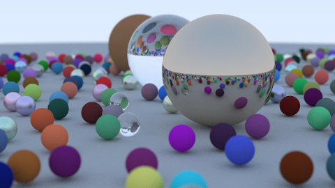
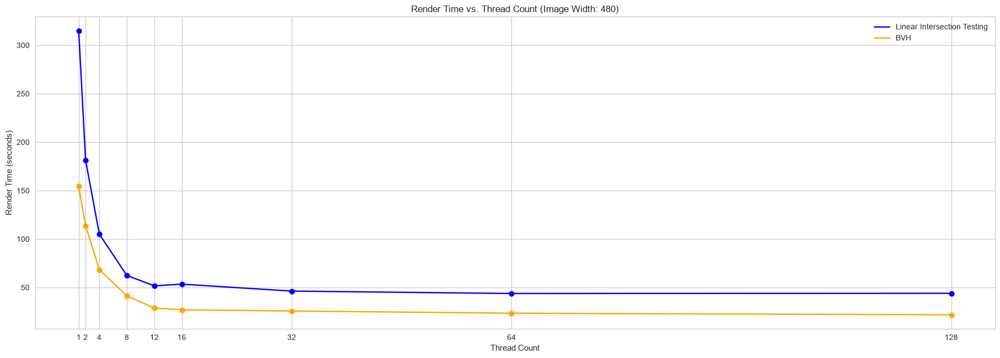

# Ray Tracing Further

## Introduction

This repo serves some fun, further personal learnings following the completion of [RTOW](https://raytracing.github.io/books/RayTracingInOneWeekend.html). There are a few features I will implement:
1. Multithreading to speed up path tracing by parallelizing over pixels (this problem is embarrassingly parallel)
   1. Implementation of Bounding Volume Hierarchies to improve ray-intersection testing complexity (adapted from this [awesome reference](https://jacco.ompf2.com/2022/04/13/how-to-build-a-bvh-part-1-basics/))
   2. Extension to CUDA if I have time
2. Enable simple procedural animation based on randomly generated scenes. 
   1. Add simple UV map to be able to visualize rotation on spheres
   2. Define each sphere with some initial velocity
   3. Add rotation mechanics
   4. Add collision detection using the inherent properties of spheres
   5. Render each frame and compile into a single animation
3. Anything else I can think of

## Running

Simply run in `./src`
```
cmake -B build
cmake --build build --config Release
build/Release/main.exe 480 32 1 > render.ppm
```

## Render Speed Optimization
These [benchmarks](notebooks/render_time.ipynb) are performed on 7800x3d, specifically rendering this scene:


Render time curves:


### Effects of Parallelization

Here, we see a clear improvement until ~16 threads. Specifically, we see a ~5.7x speedup here. 

### Bounding Volume Hierarchies

We can follow a divide-and-conquer approach to recursively prune the objects that a ray may intersect. This can help reduce our ray-intersection tests from $\mathcal{O}(n)$ where $n$ is the number of objects in the scene, to $\mathcal{O}(\log n)$ (in a balanced BVH tree).

With a simple scene of 5 spheres, we observe no improvement in speed, and in fact see an increase in render time. This is likely due to the overhead that comes with recursive calls and slab tests per ray. 

However, we do see a significant improvement when rendering a scene with a large amount of spheres, amounting to ~2x improvement, controlling for number of threads.